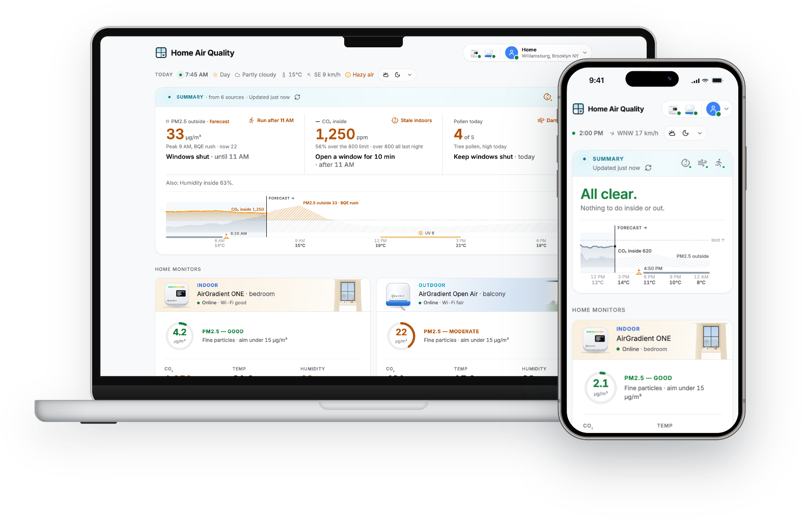
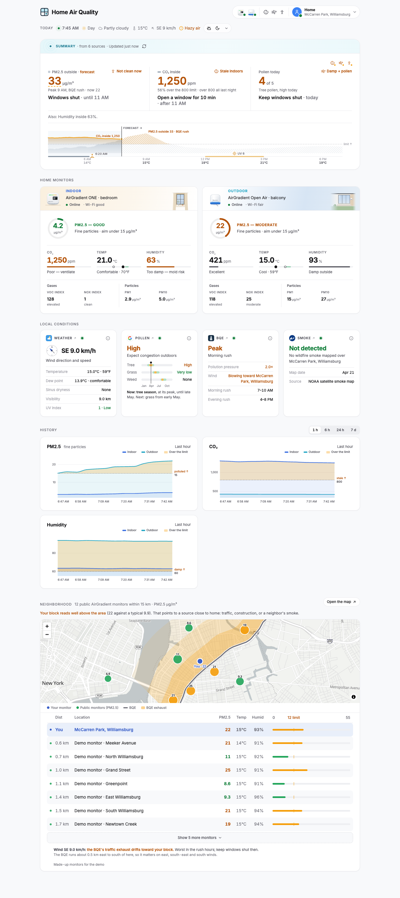

#  Home Air Quality

An app for your AirGradient monitors that tells you what to do about your air: when to open the window, when to keep it shut, when to go for a run. It combines your readings with the forecast, pollen, wildfire smoke and the public monitors around you.

**[Try the demo](https://homeair.guyon.dev)** · [Installation](#installation) · [Features](#features) · [How it works](#how-it-works)

<p align="center">
  
</p>

<sub>Screenshots from the demo, with sample data.</sub>

## Demo

[The demo](https://homeair.guyon.dev) shows an example home or the live readings of any public AirGradient monitor.

## Installation

You need one or two AirGradient monitors (indoor, outdoor or both) on AirGradient's cloud, and your API token. Works best in the US.

**With a coding agent** (Claude Code or Codex). Open your agent in an empty folder and paste:

```
Clone https://github.com/sguyon/home-air-quality and set up Home Air Quality for my home by following its SETUP.md.
```

It connects AirGradient, asks your location and profiles, writes your config and runs the page on your computer. It can then keep it running, or help you put it on a home server with Docker or online with Railway ([`DEPLOYMENT.md`](DEPLOYMENT.md)).

**With Docker,** on a home server or NAS: follow [Docker setup](DEPLOYMENT.md#docker) to create `config.toml` and enter the token in `.env`, then start Compose and open http://localhost:8000.

**Just trying it?** A fresh copy with no token opens the demo: `uv run --with-requirements requirements.txt server.py`, then http://localhost:5555.

## Features

- **Actions.** For CO₂ and humidity inside, PM2.5 and pollen outside: "Open a window for 10 min", "Keep windows shut", each with one line on why.
- **Timing.** The actions look ahead, so you get "Windows shut until 11 AM" or "Run after 11 AM", from a PM2.5 forecast scaled to your outdoor monitor (without one, to the public monitors near you when there are some).
- **Profiles.** Pick the profiles that match your home (a toddler, someone with sinus allergies, a runner), and the page says whether the air suits each of them right now.
- Charts of today with its forecast, and of each monitor's history (1 hour to 7 days)
- Weather, pollen, wildfire smoke, and a nearby highway's exhaust when the wind blows it your way
- Public AirGradient monitors nearby, to see whether bad air is regional or just around your home
- A live sky behind the page, with the real sun, clouds, rain and haze. Useless, but my toddler's favorite feature :)
- Installs on your phone's home screen like an app (a PWA): [how](SETUP.md#on-your-phone)

## Why I built it

I have two AirGradient monitors at home, one inside and one outside. AirGradient's dashboard shows their readings well, but it doesn't say what to do about them, and the rest of what matters lives in other apps: the weather, the pollen season, rush hour on the expressway a kilometer away. I wanted one place that says what to do about the air at home, for what my household cares about: a toddler's sleep, sinus allergies, and running.

My first version had an AI model write the actions, but it kept suggesting the same few things, so I turned each one into a plain rule. I plan to try AI again for patterns across weeks of readings.

It's minimal on purpose, and by necessity: I built it around what my own two monitors measure :) It's meant to be easy to extend with your coding agent: the rules are short Python functions with their numbers named at the top, and [AGENTS.md](AGENTS.md) tells an agent how the code fits together. Adding a profile of your own, like someone who cooks on gas, or a baby ([how to add one](docs/optional.md#adding-a-profile)), hasn't been tried by anyone else yet: if you do, tell me how it went in an issue, or send a pull request.

## Limitations

- **Works best in the US.** Wildfire smoke (NOAA) and the forecast and pollen links use US sources. Elsewhere, turn those off in `config.toml`: your monitors' readings, the actions, the weather and the PM2.5 forecast still work.
- **One or two monitors.** An indoor one, an outdoor one, or both. With an indoor monitor only, outdoor PM2.5 comes from a nearby public monitor or an estimate for your area; with an outdoor monitor only, the toddler profile waits for an indoor one. No rooms or several monitors of the same kind yet.
- **AirGradient's cloud.** The page reads your monitors through AirGradient's API with your token, not from the monitors on your network.
- **No road for new homes yet.** The road and its exhaust need a route file traced along the road, and nothing in the repo builds one yet. The demo has one; new homes start without.

## Data and privacy

- **Nothing is stored on the server.** No database, no accounts, no analytics: history comes from AirGradient's cloud each time, and the server's logs list which sources it called, never readings or keys. The one exception is the public demo site, which counts page views and loading speed with Vercel Web Analytics and Speed Insights (no cookies, nothing personal); a copy you run has none.
- **What leaves your server:** your AirGradient token goes only to AirGradient. Your home's position, rounded to about 1 km by the app, goes to Open-Meteo (weather and forecast) and to Google if you add a pollen key.

## How it works

The actions come from fixed rules in `summary.py` and `server.py`, not a model. Each rule compares a reading with a limit from your `config.toml` (`[limits]`). The defaults, and why:

| Limit | Default | Why |
|---|---|---|
| CO₂ inside | 800 ppm | About twice the outdoor level (around 420). Above it the room is short on fresh air, and it starts to feel stuffy; guidelines put the line between 800 and 1,000. |
| PM2.5 outside | 15 µg/m³ | The World Health Organization's guideline for a 24-hour average. Used here for any hour, so it's strict on purpose. |
| PM2.5 outside, high | 35 µg/m³ | The US EPA's 24-hour standard. Above it, sensitive people (children, asthma) should keep time outside short. |
| Humidity inside | 30–60%, comfortable up to 50% | Under 30% dries the nose and throat; over 60% helps mold and dust mites grow. The damp-room action stops at 55%. |
| Pollen | 3 of 5 | "Moderate" on Google's pollen index, where people with allergies start to feel it. |

Change any of them in `config.toml`; the comments in [`config.example.toml`](config.example.toml) say what each one does.

### The PM2.5 forecast

The server asks [Open-Meteo's Air Quality API](https://open-meteo.com/en/docs/air-quality-api) (free, no key) for hourly PM2.5 at the home, the past 24 hours and the next 24, and keeps the answer 30 minutes. For each past hour it compares your outdoor monitor's average with the forecast and takes the median ratio, kept between ×0.1 and ×3, so one odd hour doesn't sway it; the coming hours are multiplied by it. With fewer than 6 matching hours it starts the forecast from the monitor's reading now instead, and the gap fades over 6 hours. Without an outdoor monitor, the home's chosen source stands in for it: the nearby public monitor's readings, or for the area estimate the hourly median of up to 5 public outdoor monitors within 15 km (at least 2). With the model alone, the forecast is used as Open-Meteo gives it. The actions look 8 hours ahead on that curve for when PM2.5 crosses the limit.

### Corrected PM2.5

AirGradient monitors measure particles with a laser sensor (Plantower). Outdoors it reads high, more so in humid air, where particles swell with water. The US EPA compared these sensors with reference stations and published a correction that uses humidity and the sensor's non-linear response at high levels ([Barkjohn et al. 2021](https://amt.copernicus.org/articles/14/4617/2021/)). AirGradient says its indoor monitor's sensor (PMS5003) reads low in clean air, and may correct it differently ([AirGradient on low readings](https://www.airgradient.com/blog/low-readings-from-pms5003/)). AirGradient sends its own corrected value next to the raw one (`pm02_corrected` in [its API](https://api.airgradient.com/public/docs/api/v1/)): the EPA correction on an outdoor monitor; on an indoor one, whichever correction AirGradient applies to that sensor. The app shows that value for your monitors. For public outdoor monitors (the nearby ones, and the one an indoor-only home reads), AirGradient's public list gives only the raw value, so the app applies the same EPA formula, which gives the values on AirGradient's map ([AirGradient on the correction](https://meetingorganizer.copernicus.org/EGU25/EGU25-8701.html)). The rules compare these corrected values with the limits.

## Screenshots

<p align="center">
  
</p>

## Credits

- Your monitors, and the nearby public monitors: [AirGradient](https://www.airgradient.com) ([API](https://api.airgradient.com/public/docs/api/v1/), [public map](https://www.airgradient.com/map/)). Nearby monitors' data is licensed under [CC-BY-SA 4.0](https://creativecommons.org/licenses/by-sa/4.0/); each monitor's owner is named in its row on the page.
- Weather and the PM2.5 forecast: [Open-Meteo](https://open-meteo.com) ([Weather API](https://open-meteo.com/en/docs), [Air Quality API](https://open-meteo.com/en/docs/air-quality-api)).
- Pollen: [Google Pollen API](https://developers.google.com/maps/documentation/pollen) (optional, needs a key).
- Wildfire smoke: NOAA's [Hazard Mapping System](https://www.ospo.noaa.gov/products/land/hms.html).
- Map: [MapLibre](https://maplibre.org), with tiles from [OpenFreeMap](https://openfreemap.org) and map data from [OpenStreetMap](https://www.openstreetmap.org/copyright) contributors.
- Device frames in the screenshot: [Devices.css](https://github.com/picturepan2/devices.css) (MIT, `scripts/vendor/`).

## Contributing

Questions, bugs and ideas are welcome as GitHub issues. Never paste a token or key in an issue or pull request, even a partial one. To report a security problem, see [`SECURITY.md`](SECURITY.md).

Pull requests: install `requirements-dev.txt` (`pip install -r requirements-dev.txt`), run `pytest -q` and `node --test tests/*.test.mjs` first, and keep your `config.toml`, `.env` and readings out of the diff. Agents working on the code read [`AGENTS.md`](AGENTS.md).

## License

[MIT](LICENSE)
